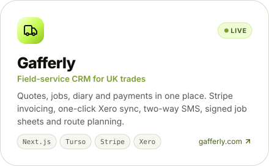
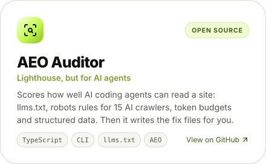
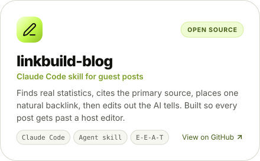
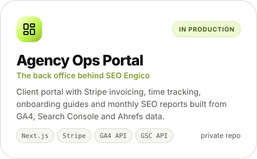
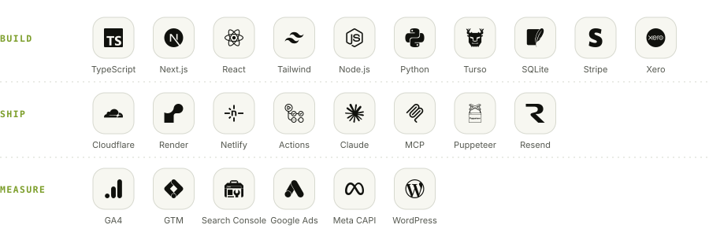

### Hey, I'm Jhonty

I trained as a mechanical engineer, ended up in search, and still treat it like an engineering problem. I co-founded [SEO Engico](https://seoengico.com) with Priyam. We do B2B SEO and link building, and we measure it on revenue rather than rankings.

Alongside the client work I write the software that runs the business: our client portal, our reporting pipeline, and [Gafferly](https://gafferly.com), a CRM we built for UK trades. Most of that code lives in private repos because it belongs to clients or to products, so this page is the public summary.

### What I'm building

<a href="https://gafferly.com"><picture><source media="(prefers-color-scheme: dark)" srcset="assets/card-gafferly-dark.svg"></picture></a>
<a href="https://github.com/JhontyBarreto/aeo-auditor"><picture><source media="(prefers-color-scheme: dark)" srcset="assets/card-aeo-auditor-dark.svg"></picture></a>

<a href="https://github.com/JhontyBarreto/linkbuild-blog"><picture><source media="(prefers-color-scheme: dark)" srcset="assets/card-linkbuild-blog-dark.svg"></picture></a>
<picture><source media="(prefers-color-scheme: dark)" srcset="assets/card-ops-portal-dark.svg"></picture>

### How we work

- **Measure first.** We install the tracking before we touch the SEO, so every report has a revenue number in it, not just a rankings table.
- **Engineer the links.** Authority gets built in phases, gated by how ready the content is. If the foundation isn't there yet, we turn the order down.
- **Ship small, check it live.** Every deploy gets verified from outside our own network before anyone is told it's done.

### Toolkit

<picture><source media="(prefers-color-scheme: dark)" srcset="assets/toolkit-dark.svg"></picture>

 

<a href="https://seoengico.com">seoengico.com</a> &nbsp;·&nbsp; <a href="https://gafferly.com">gafferly.com</a> &nbsp;·&nbsp; <a href="https://www.linkedin.com/in/jhontybarreto">LinkedIn</a>

